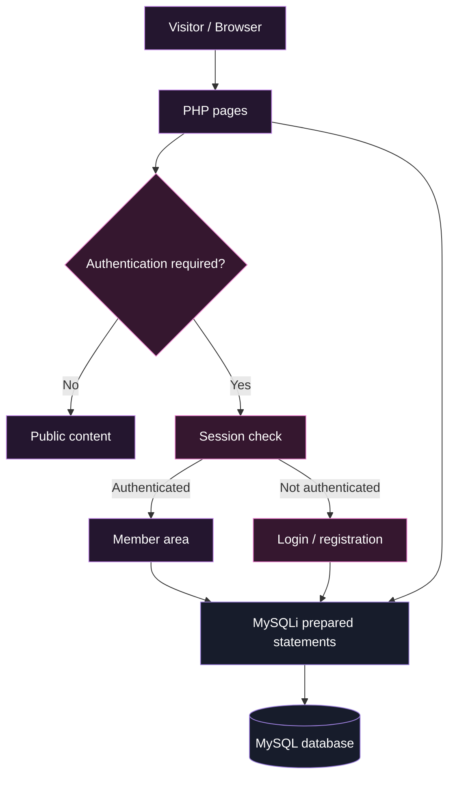

# Blue Life Harmony

A PHP and MySQL website created to raise awareness about autism and promote inclusion. The project includes public information pages, a blog-style page, a contact form, and a basic member area with registration and login.


 [](https://github.com/johannafoolchand/harmonylifeblue/actions/workflows/php.yml)

## Project at a glance

| Area | Implementation |
| --- | --- |
| Frontend | HTML, CSS and JavaScript |
| Backend | PHP 8.2+ |
| Database | MySQL / compatible MariaDB |
| Authentication | PHP password hashing and session-based member area |
| Quality | PHP syntax checks with GitHub Actions |

## Features

- Public home, about, blog, and contact pages
- User registration and login
- Password hashing with PHP's `password_hash()` and `password_verify()`
- MySQL persistence through MySQLi
- Member-only personal area
- Shared page header and footer

## Architecture

This diagram summarizes the documented request and data flow: public and member pages are served by PHP, which accesses MySQL through MySQLi. Authentication uses PHP sessions.



## Tech stack

- PHP 8.2+
- MySQL 8+ or compatible MariaDB
- HTML, CSS, JavaScript
- GitHub Actions for PHP syntax checks

## Local setup

1. Install PHP with the MySQLi extension and MySQL/MariaDB.
2. Create a database named `bluelifeharmony`.
3. Import the schema:

   ```bash
   mysql -u YOUR_DB_USER -p bluelifeharmony < scripts/db.sql
   ```

4. Copy the example environment file:

   ```bash
   cp .env.example .env
   ```

5. Configure your local PHP/Apache environment to expose `DB_HOST`, `DB_NAME`, `DB_USER`, and `DB_PASSWORD` as environment variables. Do not commit real values.
6. Configure your local web server document root to this repository and open the site in your browser.

## Security notes

- Database credentials are read from environment variables.
- Login and registration queries use prepared statements.
- Passwords are stored using PHP's password hashing API.
- Session IDs are regenerated after successful authentication.
- User-provided values displayed in the member area are HTML-escaped.

This is a learning project, not a production-ready service. Before public deployment, add CSRF protection to state-changing forms, rate limiting for authentication, secure cookie and HTTPS configuration, robust contact-form delivery, and security-focused integration tests. Rotate any database credentials that may have been used in earlier versions of this public repository.

## Database schema

The schema is in `scripts/db.sql`. It uses InnoDB and UTF-8 (`utf8mb4`) so foreign-key constraints are enforced.

## Quality checks

GitHub Actions runs PHP syntax checks on pull requests targeting `refacto` and on pushes to `refacto` or feature branches.

Run locally:

```bash
find . -type f -name "*.php" -not -path "./vendor/*" -print0 | xargs -0 -n1 php -l
```

## Project structure

```text
.
├── assets/             # CSS, JavaScript, and images
├── espaceperso/        # Member area
├── partials/           # Shared header and footer
├── scripts/
│   ├── config.php       # Environment-based database connection
│   └── db.sql           # Database schema
├── .env.example
├── index.php
├── about.php
├── blog.php
├── contact.php
├── login.php
├── signup.php
└── logout.php
```
